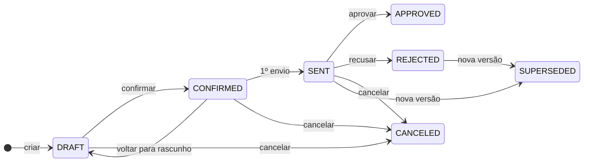

# ZBox

Sistema de gestão para serralheria e esquadrias: cadastro de clientes, dados da empresa e **orçamentos com cálculo por unidade ou por m², desconto, versionamento e histórico de auditoria**. Projeto real, construído para um cliente, com API REST em Java e interface em React.

> **Status:** back-end com 4 de 7 marcos entregues (login, clientes, empresa e orçamentos). Pedidos, pagamentos e financeiro estão em desenvolvimento. Detalhes em [Status do projeto](#status-do-projeto).

---

## Sumário

- [Destaques técnicos](#destaques-técnicos)
- [Stack](#stack)
- [Status do projeto](#status-do-projeto)
- [Arquitetura](#arquitetura)
- [Regras de negócio do módulo de orçamentos](#regras-de-negócio-do-módulo-de-orçamentos)
- [Como rodar](#como-rodar)
- [API](#api)
- [Testes](#testes)
- [Autoria](#autoria)

---

## Destaques técnicos

- **Dinheiro sem `double`.** Valores em centavos (`long`) e medidas em centímetros (`int`). Os cálculos usam `BigDecimal` com arredondamento `HALF_UP`, isolados na classe utilitária `MoneyCalculator`, coberta por testes unitários.
- **Máquina de estados do orçamento.** Rascunho, confirmado, enviado, aprovado, recusado, cancelado e substituído, com transições validadas no servidor. Transição inválida responde `409` com código `INVALID_QUOTE_STATUS_TRANSITION`.
- **Versionamento.** Um orçamento enviado ou recusado gera uma nova versão com os itens copiados. A versão antiga passa a `SUPERSEDED` e vira somente leitura. O número do orçamento é mantido e a chave única é `(number, version)`.
- **Auditoria.** Cada ação relevante (criar, editar, confirmar, enviar, aprovar, recusar, cancelar, nova versão) grava um evento em `audit_log`, com usuário, data, versão e detalhe. O histórico volta dentro da resposta do orçamento.
- **Segurança.** Autenticação stateless com JWT, senhas com BCrypt, CORS configurável e autorização por perfil (`ADMIN`, `MANAGER`, `EMPLOYEE`) com `@PreAuthorize`.
- **Erros padronizados.** Toda falha devolve o mesmo envelope JSON com um `code` estável, que o front usa para escolher a mensagem. O tratamento fica centralizado em um `@RestControllerAdvice`.
- **Configuração fora do código.** Senha do banco e segredo do JWT vêm de variáveis de ambiente.
- **Contrato primeiro.** O front e o back combinam os formatos em documentos versionados no repositório (`frontend/docs/`).

## Stack

| Camada | Tecnologias |
|---|---|
| Back-end | Java 17, Spring Boot 4.1.1, Spring Web MVC, Spring Data JPA (Hibernate), Spring Security, Bean Validation |
| Autenticação | JWT (jjwt 0.12.6), BCrypt |
| Banco de dados | MySQL 8 |
| Build e testes | Maven (wrapper incluído), JUnit |
| Front-end | React 19, TypeScript, Vite, React Router |

## Status do projeto

| Marco | Entrega | Situação |
|---|---|---|
| M0 | Login com JWT e envelope de erros | Concluído |
| M1 | Fundação: perfis, auditoria, paginação, tratamento de exceções | Concluído |
| M2 | Clientes: CRUD, ativar/desativar, busca, histórico, detecção de duplicados | Concluído |
| M3 | Dados da empresa | Concluído |
| M4 | Orçamentos: cálculo, estados, versões, auditoria | Concluído |
| M5 | Pedidos e pagamentos: conversão, andamento, entrega, pagamento com controle de concorrência, estorno | Em desenvolvimento |
| M6 | Financeiro e dashboard | Planejado |
| M7 | PDF no servidor, link de compartilhamento e demais extras | Planejado |

## Arquitetura

API em camadas, com responsabilidades separadas:

```
backend/src/main/java/com/zbox/backend/
├── controller/   Endpoints REST (entrada e saída HTTP)
├── service/      Regras de negócio e transações
├── repository/   Acesso a dados (Spring Data JPA, consultas JPQL)
├── model/        Entidades JPA
├── dto/          Objetos de requisição e resposta
├── mapper/       Conversão entidade <-> DTO
├── enums/        Status, perfis, códigos de erro
├── exception/    BusinessException e GlobalExceptionHandler
├── security/     JWT, filtro de autenticação, configuração do Spring Security
└── util/         MoneyCalculator, TextUtils
```

Fluxo de uma requisição: `Controller` valida o corpo (Bean Validation) e delega ao `Service`, que aplica as regras, usa os `Repository` e devolve DTOs. Erros de negócio sobem como `BusinessException(ErrorCode, mensagem)` e o `GlobalExceptionHandler` os converte no envelope padrão, com o status HTTP definido no próprio `ErrorCode`.

## Regras de negócio do módulo de orçamentos

### Ciclo de vida



- A edição (`PUT`) só é permitida em `DRAFT`. Fora dele, `409 QUOTE_NOT_EDITABLE`.
- Confirmar é **idempotente**: confirmar um orçamento já confirmado devolve `200` sem registrar novo evento.
- Confirmar exige ao menos um item, total maior que zero e cliente ativo. Senão, `422 QUOTE_CANNOT_BE_CONFIRMED`.
- O primeiro envio muda o status para `SENT`. Envios seguintes só registram o evento no histórico.
- Aprovar e recusar registram o método ou o motivo, e a data da decisão.

### Cálculo

| Item | Fórmula |
|---|---|
| Por unidade (`UNIT`) | quantidade × preço unitário |
| Por área (`AREA`) | quantidade × largura(cm) × altura(cm) × preço por m² ÷ 10.000, arredondado com `HALF_UP` |
| Desconto percentual | subtotal × valor ÷ 10.000, onde o valor está em centésimos de % (5% = `500`) |
| Desconto em valor | em centavos, de 0 até o subtotal |
| Total | subtotal − desconto |

Exemplo coberto por teste: subtotal de `354000` centavos com 5% de desconto resulta em desconto de `17700` e total de `336300` (R$ 3.363,00).

O cliente da API nunca envia subtotal nem total: o servidor calcula tudo e devolve.

## Como rodar

### Pré-requisitos

- Java 17
- MySQL 8
- Node.js (apenas para o front-end)

### 1. Banco de dados

Crie o banco e um usuário dedicado (troque a senha):

```sql
CREATE DATABASE zbox_db CHARACTER SET utf8mb4;
CREATE USER 'developer'@'%' IDENTIFIED BY 'SUA_SENHA_AQUI';
GRANT ALL PRIVILEGES ON zbox_db.* TO 'developer'@'%';
```

As tabelas são criadas automaticamente na primeira execução (`spring.jpa.hibernate.ddl-auto=update`, configuração de desenvolvimento).

### 2. Variáveis de ambiente

| Variável | Para que serve |
|---|---|
| `DB_PASSWORD` | Senha do usuário `developer` do MySQL |
| `JWT_SECRET` | Segredo usado para assinar os tokens. Use pelo menos 32 caracteres aleatórios (o ideal é 64) |

Exemplo de geração do segredo e exportação no Linux/macOS:

```bash
export JWT_SECRET="$(openssl rand -base64 48)"
export DB_PASSWORD="SUA_SENHA_AQUI"
```

No Windows (PowerShell), grave de forma permanente e abra um terminal novo:

```powershell
setx DB_PASSWORD 'SUA_SENHA_AQUI'
```

Nunca versione esses valores.

### 3. Subir a API

```bash
cd backend
./mvnw spring-boot:run        # Windows: mvnw.cmd spring-boot:run
```

A API sobe em `http://localhost:8080`. A origem liberada no CORS é configurada em `cors.allowed-origins` (padrão: `http://localhost:5173`).

### 4. Primeiro acesso

Ainda não existe tela de cadastro de usuários nem carga inicial de dados. Para o primeiro acesso, insira um registro na tabela `usuario` com os campos `usuario` (login), `senha` (hash **BCrypt**), `name` e `role` (`ADMIN`, `MANAGER` ou `EMPLOYEE`). Depois autentique em `POST /api/auth/login` e use o token no cabeçalho `Authorization: Bearer <token>`.

### 5. Front-end (opcional)

```bash
cd frontend
npm install
npm run dev          # conectado à API local
npm run dev:demo     # modo demonstração, com dados simulados
```

## API

São **23 endpoints**. Todos, exceto o login, exigem `Authorization: Bearer <token>`.

| Recurso | Endpoints | Resumo |
|---|---|---|
| Autenticação | 1 | `POST /api/auth/login` |
| Empresa | 2 | `GET` e `PUT /api/company` (alteração apenas `ADMIN` e `MANAGER`) |
| Clientes | 8 | CRUD, busca paginada, histórico, duplicados e ativar/desativar (apenas `ADMIN` e `MANAGER`) |
| Orçamentos | 12 | Criar, listar com filtros, contagem por status, editar, confirmar, enviar, aprovar, recusar, cancelar e nova versão |

<details>
<summary><strong>Endpoints de orçamentos</strong></summary>

| Método | Rota | Descrição |
|---|---|---|
| `POST` | `/api/quotes` | Cria rascunho (versão 1) com número sequencial |
| `GET` | `/api/quotes` | Lista a versão atual. Filtros: `search`, `status`, `period`, `customerId`, `page`, `size` |
| `GET` | `/api/quotes/counts` | Contagem por status |
| `GET` | `/api/quotes/{id}?version=n` | Detalhe com itens e histórico. Sem `version`, devolve a versão atual |
| `PUT` | `/api/quotes/{id}` | Edita itens, desconto e condições (somente rascunho) |
| `POST` | `/api/quotes/{id}/confirm` | Confirma (idempotente) |
| `POST` | `/api/quotes/{id}/back-to-draft` | Volta para rascunho |
| `POST` | `/api/quotes/{id}/dispatches` | Registra envio (`WHATSAPP`, `PDF`, `PRINT`) |
| `POST` | `/api/quotes/{id}/approve` | Aprova (`WHATSAPP`, `IN_PERSON`, `PHONE`) |
| `POST` | `/api/quotes/{id}/reject` | Recusa, com motivo obrigatório |
| `POST` | `/api/quotes/{id}/cancel` | Cancela, com motivo obrigatório |
| `POST` | `/api/quotes/{id}/versions` | Cria nova versão a partir de um orçamento enviado ou recusado |

</details>

### Formato de erro

```json
{
  "timestamp": "2026-11-23T19:11:14Z",
  "status": 409,
  "code": "INVALID_QUOTE_STATUS_TRANSITION",
  "message": "Operação não permitida para o status atual do orçamento.",
  "path": "/api/quotes/7/approve"
}
```

Erros de validação de campo (`400 VALIDATION_ERROR`) acrescentam a lista `fieldErrors`, com o campo no formato `items[1].unitPriceCents`.

### Contratos

Os formatos de requisição e resposta são documentados em [`frontend/docs`](frontend/docs):

- [Clientes](frontend/docs/contrato-api-clientes.md)
- [Empresa](frontend/docs/contrato-api-empresa.md)
- [Orçamentos](frontend/docs/contrato-api-orcamentos.md)
- [Pedidos e financeiro](frontend/docs/contrato-api-pedidos-financeiro.md) (planejado)

## Testes

```bash
cd backend
./mvnw test
```

## Autoria

- **Back-end (API, regras de negócio, banco, segurança e testes):** José Inácio. Desenvolvimento 100% próprio.
- **Front-end (React e interface):** Thayna.

Contato: [GitHub](https://github.com/Dev-Inacio) · [LinkedIn](https://www.linkedin.com/in/inaciojose/)
